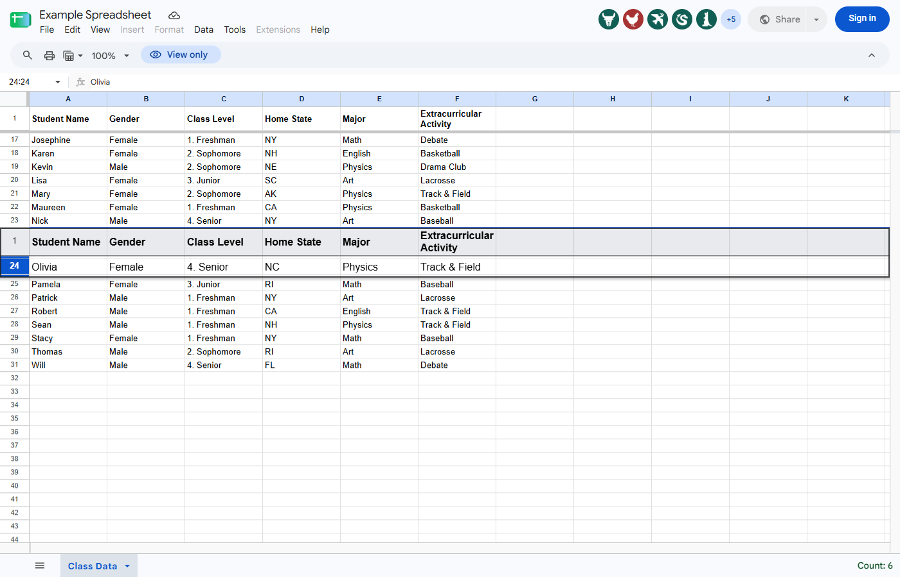
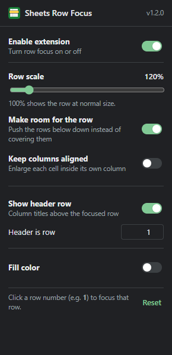
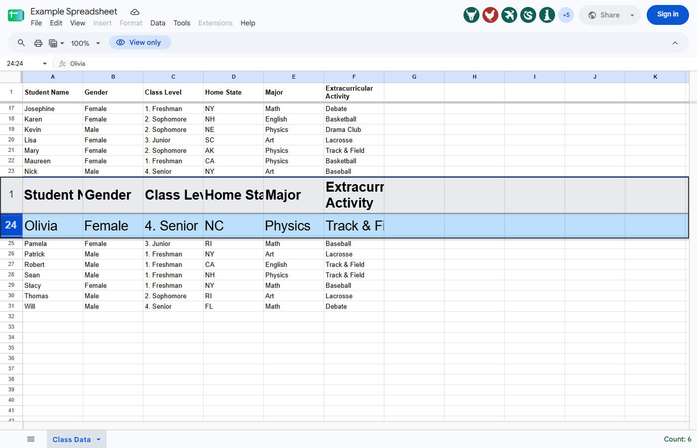

# Sheets Row Focus

A Chrome extension that makes the row you're working on in Google Sheets easier to read. Click a row number and that row is **magnified** (with sharp, full-resolution text) and can be **highlighted** with a fill color. Select anything else and it goes back to normal.



## Features

- **One row at a time.** Click a row number (e.g. **1**) and only row 1 is affected.
- **Reverts automatically.** Selecting another row moves the focus to it. Clicking any cell, a column, or a multi-row range removes it.
- **Adjustable magnification.** Scale from 100% (highlight only) to 300%.
- **Sharp text at any size.** The row's text is redrawn as real text at the enlarged size, not stretched pixels, so it stays crisp at 300% and on any display.
- **Optional column alignment** (off by default). Each cell is enlarged inside its own column, around its text alignment point, so the magnified row lines up with the rows above and below and cell padding doesn't grow.
- **Header row above the row.** Optionally shows your column titles (row 1 by default, or any row you choose) directly above the focused row, even after the header has scrolled off screen.
- **Makes room for the row.** The magnified row pushes the rows below it down instead of covering them, so the rows above and below stay fully visible and clickable. You can switch this off to overlay the row instead.
- **Optional fill color** (off by default). Turn it on or off, pick any color (six presets included) and set its strength. Text and gridlines stay dark.
- **Clicks go where you see them.** Clicking a cell inside the magnified row selects the cell that is drawn there, not the one hidden underneath.
- **Stays out of the way.** It hides while you type in a cell, doesn't cover Sheets' menus and dialogs, and follows the row as you scroll.
- **Google Sheets only.** The script runs only on `https://docs.google.com/spreadsheets/*`. The toolbar button is greyed out on every other site.
- **Live settings.** Changes in the popup apply to open sheets immediately and sync across your Chrome profile.

<p align="center">
  
  &nbsp;&nbsp;
  
</p>

## Installation

The extension isn't on the Chrome Web Store yet, so you load it unpacked:

1. Download this repository (**Code → Download ZIP**, then extract it) or clone it:
   ```bash
   git clone https://github.com/MoeezHyper/Gsheet-extension.git
   ```
2. Open `chrome://extensions` in Chrome.
3. Turn on **Developer mode** (top right).
4. Click **Load unpacked** and select the project folder (the one containing `manifest.json`).
5. Open or refresh a Google Sheet.

**Updating:** after pulling new code, click the reload icon on the extension's card in `chrome://extensions`, then refresh your Sheets tabs. The version is shown at the top of the popup. Sheets that were already open also start working right away.

It also works in other Chromium browsers that support Manifest V3 extensions, such as Edge, Brave and Opera.

## Usage

| Action | Result |
| --- | --- |
| Click a row number | That row is magnified and filled |
| Press <kbd>Shift</kbd>+<kbd>Space</kbd> **twice** | Same as clicking the row number (the first press selects only the row's data range) |
| Click another row number | Focus moves to the new row |
| Click any cell, column, or select several rows | Focus is removed |
| Start typing in a cell | Overlay hides until you finish editing |

Click the toolbar icon on a Google Sheets tab to change the settings:

| Setting | Default | Range |
| --- | --- | --- |
| Enable extension | On | — |
| Row scale | 120% | 100–300% |
| Make room for the row | On | On = push the rows below down; Off = draw the magnified row over its neighbours |
| Keep columns aligned | Off | On = enlarge each cell inside its column; Off = enlarge the row as one picture |
| Show header row | On | Show the column titles above the focused row |
| Header is row | 1 | Any row number |
| Fill color | Off (`#fff59d` yellow when turned on) | Any color |
| Fill strength | 60% | 10–100% |

**Reset** restores the defaults.

## How it works

Google Sheets draws its grid on a `<canvas>`, so there are no DOM rows you could resize or restyle. The extension works around this:

1. **Detect the selection.** The Name Box (`#t-name-box`) shows `5:5` when exactly one whole row is selected. It is checked every 100 ms and immediately after mouse and keyboard input. Text you are still typing into the Name Box is ignored until you press Enter.
2. **Find the row on screen.** Sheets draws the selection as DOM `div.selection` elements, which give the row's exact position. Ctrl+click multi-range selections and collaborators' selections are detected and ignored.
3. **Draw the magnified copy.** That strip of the grid canvas is copied onto an overlay canvas, enlarged and tinted with a `multiply` blend, so white backgrounds take the color while text stays dark. In "make room" mode, the rows below are redrawn at normal size, shifted down by the extra height. It accounts for high-DPI screens and repaints as you scroll.
4. **Keep columns aligned.** The column edges are read from the grey separator lines in the column-letter header band. Each cell is enlarged around its text (left-aligned text grows from its start, numbers from their end, centred text from the middle) and clipped to its own column.
5. **Sharp text.** Sheets draws each cell's text with the canvas `fillText` call. A small script (`text-recorder.js`) runs in the page before Sheets starts and keeps a record of the text on the grid canvas: the string, font, colour, position, clip area and the cell background beneath it. The record follows Sheets' own drawing, so text painted over is dropped and text moved by scrolling (Sheets scrolls by copying the canvas onto itself) moves with it. Before any text is redrawn, it is checked against the real pixels (once per row selection, after Sheets repaints the row, and every few seconds). Around and under the text there must be only the cell background, the text colour and blends of the two. Underlines and strikethroughs found there are measured and redrawn too. Text on a chip, next to an icon or over mixed backgrounds keeps the stretched pixels instead, so nothing is ever painted over. The overlay then wipes the stretched glyphs and redraws the text at the enlarged size, so it is as crisp as normal text. Backgrounds, borders and images still come from the stretched copy. If the record isn't available for the row, for example in a sheet that was already open when the extension was installed and hasn't been repainted since, the stretched copy is shown as before.
6. **Show the header row.** Row edges are read from the separator lines in the row-number column (a thick bar marks frozen rows), which locates the header row on screen. Its pixels are cached whenever it's visible, so it can still be drawn after it scrolls away; the cached copy follows horizontal scrolling.
7. **Map clicks back.** The overlay has `pointer-events: none`. Mouse events that land on it are sent on to the real cell at the un-magnified (or un-shifted) position. If a drag leaves the strip, Sheets gets the real coordinates for the rest of it, so drag-select and auto-scroll still work.

## Project structure

```
├── manifest.json     Extension manifest (MV3)
├── background.js     Enables the toolbar button only on Sheets; injects into already-open tabs on install/update
├── content.js        Selection detection, overlay rendering, click remapping
├── text-recorder.js  Runs in the page; records the text Sheets draws so it can be redrawn sharply
├── content.css       Overlay styles
├── settings.js       Shared settings defaults, validation and storage helpers
├── popup.html/.css/.js   Settings popup
├── icons/            Extension icons (16, 32, 48, 128 px)
├── tests/e2e.js      End-to-end test suite (Puppeteer)
└── docs/             README screenshots
```

### Permissions

| Permission | Why |
| --- | --- |
| `storage` | Save your settings (synced with your Chrome profile) |
| `declarativeContent` | Enable the toolbar button only on Google Sheets |
| `scripting` + host access to `docs.google.com/spreadsheets/*` | Activate in Sheets tabs that were open when the extension was installed or updated |

The extension makes no network requests and collects no data.

## Development

After editing the source, click the reload icon on the extension's card in `chrome://extensions`. Open Sheets tabs pick up the new version automatically.

### Running the tests

The end-to-end suite loads the extension into Chrome for Testing and drives a live, public, read-only Google Sheet. It checks about 100 behaviors: selection and revert, scaling and fill rendering, sharp text (measured against the stretched fallback, including text on a chip, a strikethrough, scrolled rows and late injection), column alignment, the header row (live and cached), making room for the row (pixel-sampled from screenshots), click remapping, drag, multi-range, scrolling, popup controls, live settings, extension reload, and that nothing runs on other sites.

```bash
npm install
npm run browser:install   # downloads Chrome for Testing, if npm skipped Puppeteer's postinstall
npm test                  # headless
npm run test:headful      # watch it run
```

`npm run perf` benchmarks CPU time and memory with and without the extension on the same sheet.

Screenshots from the run are saved to `tests/output/`. You need an internet connection, and the tests depend on Google's sample sheet staying public.

### Packaging

To publish to the Chrome Web Store, zip the extension files only (`manifest.json`, `*.js` except tests, `*.css`, `popup.html`, `icons/`). Leave out `tests/`, `docs/`, `node_modules/` and `package*.json`.

## Performance

Measured with `npm run perf` on the sample sheet (Chrome, 1400×900 window):

| Scenario | Extra CPU (one core) | Extra memory |
| --- | --- | --- |
| No row focused | ~0.2% (Name Box check every 100 ms) | ~0 |
| Row focused, idle | ~0.2–1.3% | 0.5–1.8 MB overlay mode; 3 MB push mode (12 MB on a 200% display) |
| Row focused, scrolling | ~8–13% while scrolling | same as above |

The row is tracked every frame only for a short burst after scrolling, typing, resizing or a change in the grid. Otherwise it refreshes twice a second. Column and header analysis reads the grid's pixels in a single read, is reused while scrolling, and is redone only when the row, sheet, zoom or settings change, or every 5 seconds at rest. The overlay's pixel buffer is released whenever the overlay is hidden. The background service worker sleeps when idle.

## Limitations

- At high scale, the magnified row is wider than the screen, so columns on the far right are cut off.
- Only text is redrawn sharply. Checkboxes, chips, images and cell borders in the magnified row are enlarged pixels and look softer at high scale. Text sitting on a chip or pill, rotated text, and text more than 240 px down a very tall wrapped row are also shown as enlarged pixels.
- In a sheet that was already open when the extension was installed, text becomes sharp once Sheets repaints that part of the grid (scroll it away and back, or reload the tab).
- With "make room" on, the rows at the very bottom of the screen are pushed out of view until you select something else. Floating charts and images in the pushed area are hidden while a row is focused.
- With "keep columns aligned" on, text that no longer fits its enlarged cell is clipped at the column edge (like Sheets does).
- The header row can only be shown once it has been on screen (it is captured when the sheet opens, or whenever you scroll past it). Its cached copy is refreshed whenever it's visible again; if you change the header row's contents while it's off screen, the old copy is shown until then.
- If there isn't enough room below the row (e.g. the last visible row), it is drawn over its neighbours instead.
- If a named range exactly matches the selected row, the Name Box shows that name instead of `5:5`, and the row isn't detected.
- The extension relies on Google Sheets' internal page structure. A future Sheets update could break it until the extension is updated.
